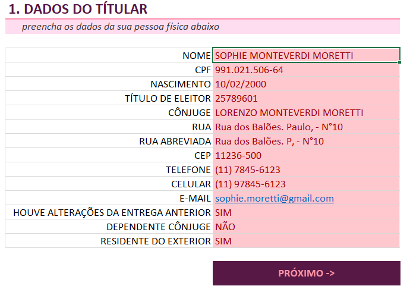
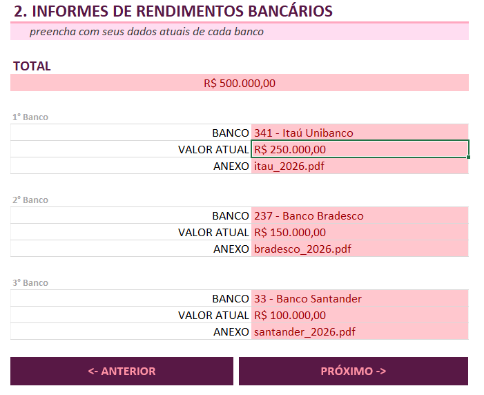
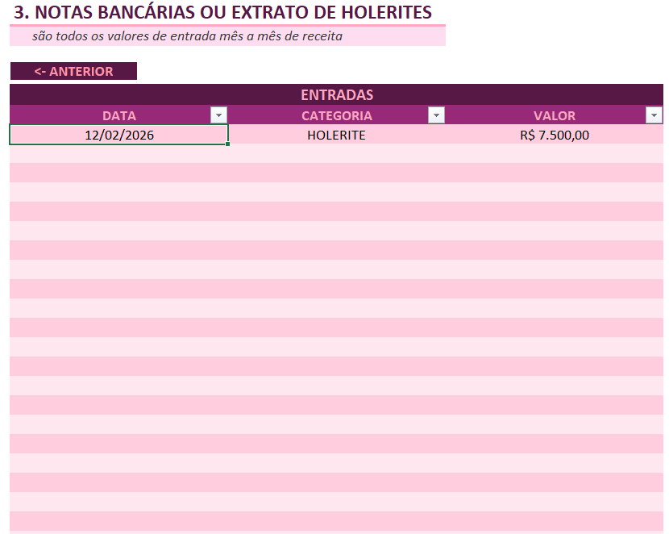

# Pink Money: organizador de Imposto de Renda

Planilha que reúne, em um só lugar, as informações que a pessoa física precisa separar antes de preencher a declaração de Imposto de Renda: dados do titular, informes de rendimentos bancários e as entradas de receita mês a mês.

> **Aviso:** todos os dados que aparecem no arquivo (nome, CPF, endereço, e-mail, bancos, valores e datas) são **fictícios e de exemplo**, não dados reais. A planilha organiza informações, mas **não calcula o imposto** e não substitui o programa da Receita Federal nem um contador.

**Arquivo:** [pink_money_organizador_ir.xlsx](pink_money_organizador_ir.xlsx)

## Sobre o projeto

Este projeto é a minha versão de um organizador de IR construído a partir da planilha do professor Felipe Aguiar. Mantive a estrutura e os recursos do Excel da original e criei a minha própria identidade visual e dados de exemplo. A seção [O que mudei em relação à planilha do professor](#o-que-mudei-em-relação-à-planilha-do-professor) detalha as diferenças.

## Como usar

1. Abra o arquivo no Excel.
2. Preencha apenas as células coloridas de cada aba. O restante da planilha é protegido.
3. Percorra as abas na ordem: `TITULAR`, `INFORMES` e `NOTAS`.
4. Use os ícones com link no topo de cada aba para navegar entre elas.

## O que a planilha organiza

A planilha tem três abas visíveis e uma aba oculta de apoio.

| Aba | O que organiza | Onde preencher |
|---|---|---|
| `TITULAR` | Dados da pessoa física: nome, CPF, data de nascimento, título de eleitor, cônjuge, endereço (inclusive uma versão abreviada), CEP, telefone, celular e e-mail. Também três perguntas de sim ou não: se houve alterações em relação à entrega anterior, se há dependente cônjuge e se é residente no exterior | `D6:D19` |
| `INFORMES` | Informes de rendimentos de até três bancos: banco, valor atual e nome do arquivo anexo. Mostra o total somado dos três bancos | `D10:D12`, `D15:D17` e `D20:D22` (total em `C7`) |
| `NOTAS` | Entradas de receita mês a mês, em uma tabela com data, categoria (holerite, CNPJ ou freelance) e valor | `C9:E37` (29 linhas) |
| `TABELAS` (oculta) | Lista de 50 bancos, usada para a lista suspensa da aba `INFORMES` | Não é preenchida |

## Recursos do Excel usados e como funcionam

### SOMA (total dos informes)

Em `INFORMES!C7`, a fórmula soma o valor atual dos três bancos:

```
=SOMA(D11; D16; D21)
```

Em inglês, a função se chama `SUM`. O resultado aparece em formato de moeda (R$).

### Validação de dados em lista

Três listas suspensas impedem respostas fora do padrão:

| Células | Opções | Aba |
|---|---|---|
| `D17:D19` | SIM, NÃO | `TITULAR` |
| `D9:D37` | HOLERITE, CNPJ, FREELANCE | `NOTAS` |
| `D10`, `D15`, `D20` | Os 50 bancos da aba `TABELAS` (intervalo `TABELAS!$A$2:$A$51`) | `INFORMES` |

A lista de bancos tem mensagens configuradas. Ao selecionar a célula, aparece o aviso "Informe um banco vinculado ao seu CPF". Se o valor digitado não estiver na lista, o Excel mostra o erro "Banco não encontrado" com a orientação "Informe um banco da lista".

### Lista vinda de outra aba

As opções de banco ficam na aba oculta `TABELAS` (coluna `A`, com o cabeçalho "bancos"). Assim a aba `INFORMES` fica limpa e a lista pode ser ampliada em um único lugar.

> Para ver a aba `TABELAS`: clique com o botão direito em qualquer aba, escolha "Reexibir" e selecione `TABELAS`.

### Tabela do Excel

Na aba `NOTAS`, as entradas ficam em uma tabela do Excel chamada `Tabela1` (intervalo `C8:E37`), com as colunas `DATA`, `CATEGORIA` e `VALOR`, filtros no cabeçalho e linhas alternadas.

### Formatos de número

Os formatos aplicam máscaras e deixam os dados legíveis sem que a pessoa precise digitar pontos e traços:

| Campo | Formato |
|---|---|
| CPF | `000.000.000-00` |
| CEP | `00000-000` |
| Telefone | `(00) 0000-0000` |
| Celular | `(00) 00000-0000` |
| Valores | `R$ 0,00` |
| Data (aba `NOTAS`) | Data curta (dd/mm/aaaa no Excel em português) |

### Proteção da planilha

As três abas visíveis são protegidas, **sem senha**. Só as células de preenchimento ficam desbloqueadas (`TITULAR!D6:D19`, as nove células de dados dos bancos em `INFORMES` e a tabela `NOTAS!C9:E37`). Isso evita apagar rótulos e fórmulas sem querer. Para editar a estrutura, use "Revisão" > "Desproteger Planilha".

### Links

- **Navegação:** imagens no topo de cada aba têm hiperlinks que levam às outras abas.
- **E-mail:** o campo de e-mail do titular (`TITULAR!D16`) é um link que abre uma mensagem com assunto pronto.
- **LinkedIn:** uma das imagens leva ao meu perfil.

## Estrutura do repositório

```
pink-money-organizador-ir/
├── README.md
├── pink_money_organizador_ir.xlsx
└── images/
    ├── titular.png
    ├── informes.png
    └── notas.png
```

## O que mudei em relação à planilha do professor

**O que mantive:** as três abas (`TITULAR`, `INFORMES` e `NOTAS`) e a aba oculta `TABELAS`, os campos de cada aba, a lista de 50 bancos (idêntica à original), as três listas suspensas, a fórmula de total, os formatos de CPF, CEP, telefone e valores, a tabela do Excel, a proteção sem senha e os links de navegação.

**O que mudei:**

- **Identidade visual Pink Money:** criei a minha identidade, com logo de diamante em rosa e roxo, nas imagens das abas, e células de preenchimento em rosa (na original são amarelas). O estilo da tabela da aba `NOTAS` também é diferente.
- **Dados de exemplo:** troquei todos os dados fictícios por novos. O ano-base passou de 2025 para 2026, os bancos de exemplo são outros (Itaú, Bradesco e Santander) e cada banco tem o seu próprio anexo de exemplo (`itau_2026.pdf`, `bradesco_2026.pdf` e `santander_2026.pdf`), enquanto na original os três usavam o mesmo nome de arquivo.
- **Mais linhas nas notas:** a tabela da aba `NOTAS` e a lista suspensa de categorias vão até a linha 37 (29 linhas), e na original vão até a linha 35 (27 linhas).
- **Formato da data nas notas:** as datas aparecem no formato curto (dd/mm/aaaa), e na original aparecem como mês e ano por extenso.
- **Layout:** ajustei a largura das colunas e as células mescladas dos títulos.
- **Links pessoais:** os links de LinkedIn e de e-mail apontam para o meu perfil e para um e-mail fictício.

## Evidência de que funciona

<!-- Suba os prints para a pasta images/ com os nomes abaixo, ou ajuste os nomes dos arquivos. -->

| Aba `TITULAR` | Aba `INFORMES` | Aba `NOTAS` |
|---|---|---|
|  |  |  |

No exemplo da aba `INFORMES`, os três bancos somam R$ 500.000,00 (R$ 250.000,00 + R$ 150.000,00 + R$ 100.000,00), que é o valor mostrado no total.

## Limitações

- A planilha organiza as informações. Ela não calcula o imposto devido nem valida os dados contra a Receita Federal.
- Os informes aceitam no máximo três bancos, e a aba `NOTAS` aceita até 29 lançamentos. Para ampliar, é preciso desproteger a planilha e estender a tabela.
- Os anexos são apenas nomes de arquivo digitados na célula. A planilha não guarda nem abre os documentos.
- A lista de bancos tem 50 instituições e é atualizada à mão, na aba oculta `TABELAS`.
